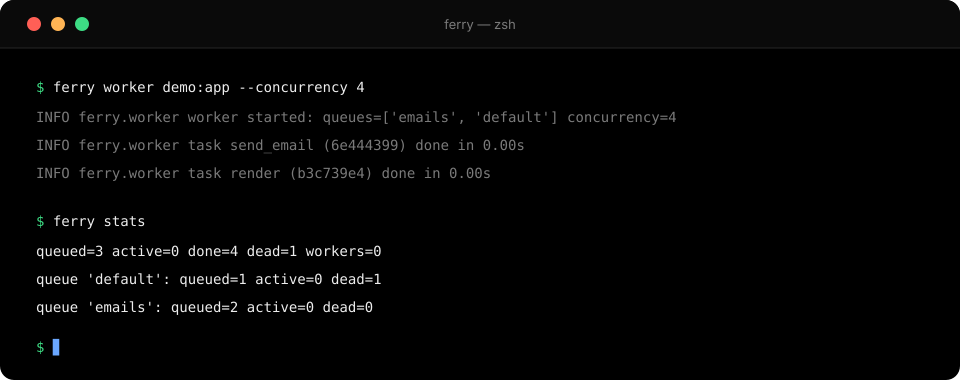
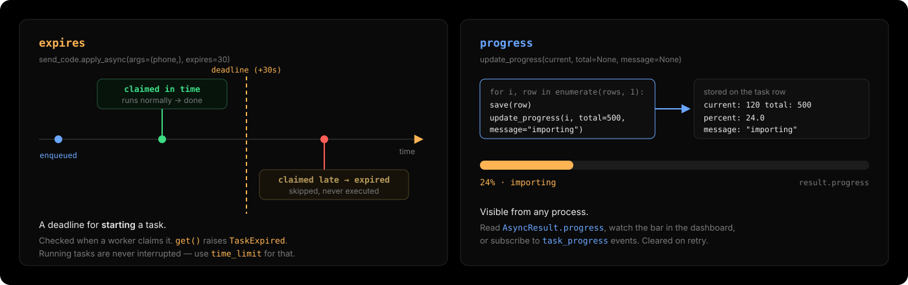
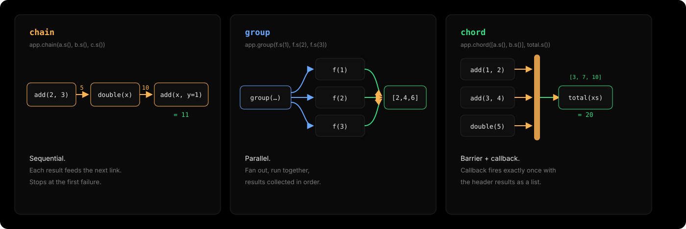
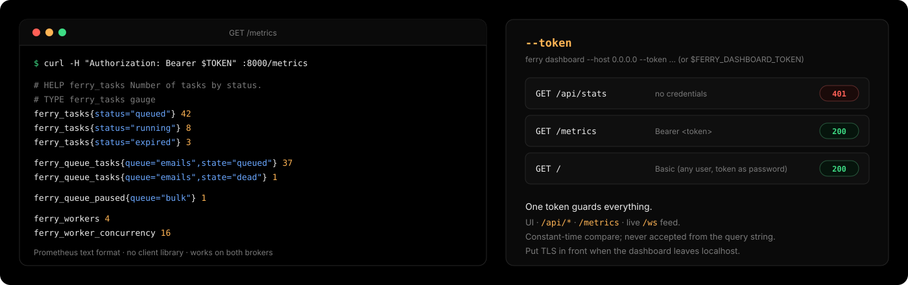

# Ferry ⛴

[](https://github.com/Sanjays2402/ferry/actions/workflows/ci.yml)
[](https://www.python.org/)
[](LICENSE)

**Ferry carries your background work across the river.** A lightweight distributed task queue for Python — SQLite-simple to start, production-serious when it counts: priorities, retries with backoff, delayed and cron-scheduled tasks, expiry deadlines, progress reporting, a dead-letter queue, a live dashboard, and Prometheus metrics.

[](#dashboard)

**[Run Ferry locally →](#quick-start)** · [Explore the dashboard](#dashboard)

Watch queue activity, inspect a task, and retry failed work from the local dashboard.

## Quick start

Requires Python 3.10+. Install from source with dashboard support:

```bash
git clone https://github.com/Sanjays2402/ferry.git
cd ferry
python3 -m venv .venv
source .venv/bin/activate  # Windows: .venv\\Scripts\\activate
python -m pip install -e ".[dashboard]"
```

Define a task in `myapp.py` using the example below, then start the worker and dashboard in separate activated terminals. Open **http://localhost:8000**. The dashboard runs locally; no publicly hosted demo is required.

```python
from ferry import Ferry

app = Ferry("myapp", broker="sqlite:///ferry.db")

@app.task(queue="emails", max_retries=5)
def send_email(to: str, subject: str) -> str:
    ...  # talk to your SMTP provider

result = send_email.delay("ada@example.com", subject="welcome aboard")
print(result.get(timeout=30))  # blocks until done
```

```bash
ferry worker myapp:app --concurrency 8   # run workers
ferry beat myapp:app                     # run the scheduler (one per broker)
ferry dashboard --port 8000              # live dashboard at localhost:8000
```


## Why Ferry

Most task queues make you choose: **simple** (a Redis list and hope) or **serious** (Celery's operational sprawl). Ferry starts with a single SQLite file — no broker to install, no daemon to babysit — and grows with you:

- **Atomic claiming** — tasks are claimed with a single `UPDATE … RETURNING`, so any number of workers across processes and machines share one broker with zero double-execution.
- **Real retry semantics** — exponential backoff with jitter, per-task tunables, and a dead-letter queue for poison messages.
- **Scheduling built in** — `countdown`/`eta` for delayed tasks, cron expressions for periodic ones, with dedup so a schedule slot never enqueues twice.
- **Crash recovery** — workers heartbeat; the beat requeues tasks claimed by workers that died mid-flight.
- **Live dashboard** — queue depth, throughput chart, per-task drill-down, worker list, one-click retry and purge.

## Features

| Area | Details |
|---|---|
| Queues | Named queues, per-task priority (higher runs first, FIFO within a level) |
| Retries | `max_retries`, exponential backoff + jitter, `retry_backoff_base`/`max` per task |
| Scheduling | `countdown`, `eta`, `@app.periodic("*/5 * * * *")` cron (standard 5-field syntax, evaluated in UTC; Sunday is `0` or `7`) |
| Reliability | Dead-letter queue, stale-claim recovery, graceful worker shutdown |
| Observability | Events API (`task_enqueued/succeeded/failed/dead`), live dashboard |
| Payloads | JSON with datetime/date/UUID/bytes/set support; strict errors on the rest |
| Canvases | `chain`, `group`, `chord` with `Task.s()`/`Task.si()` signatures |
| Queue control | Pause/resume queues — workers skip paused queues until resumed |
| Deduplication | `dedupe_key` on `apply_async` collapses pending duplicates into one task |
| Result TTL | `Ferry(result_ttl=…)` expires old result payloads; `get()` raises `ResultExpired` |
| Task expiry | `expires=` (seconds or datetime) skips tasks that waited too long; `AsyncResult.get()` raises `TaskExpired` |
| Progress | `update_progress(i, total=n)` inside a task; read `result.progress`, watch it in the dashboard |
| Async tasks | `async def` tasks run natively on workers; `await result.aget()` in async code |
| Inspection | `ferry tasks` and `ferry inspect <id>` show state, args, result, progress and errors |
| Metrics | Prometheus `/metrics` endpoint on the dashboard — queue depth, workers, paused queues |
| Dashboard auth | `ferry dashboard --token …` protects the UI, API, `/metrics` and the live feed |
| Brokers | SQLite out of the box (WAL mode); Redis via `redis://` URLs |

## Architecture


Workers are stateless and horizontally scalable — point any number of them at the same broker file (or Redis URL) and they coordinate through atomic claims. The beat is the only singleton: run exactly one per broker.

## Project layout

```
ferry/
├── __init__.py        public API
├── app.py             Ferry app, @app.task / @app.periodic, Task.handle
├── broker.py          SQLite broker: enqueue, atomic claim, ack, stats
├── redis_broker.py    Redis broker: same API, Lua-atomic claims, sorted-set queues
├── worker.py          thread-pool worker, retries, graceful shutdown
├── scheduler.py       beat: cron scheduling + stale-claim recovery
├── cron.py            cron expression parser
├── results.py         AsyncResult / TaskFailed / ResultExpired
├── events.py          in-process lifecycle event bus
├── context.py         per-task context: update_progress()
├── metrics.py         Prometheus text-format rendering
├── dashboard.py       FastAPI app + WebSocket live feed, token auth, /metrics
├── static/            dashboard UI (no build step)
├── cli.py             `ferry worker|beat|dashboard|stats|purge|pause|resume|retry-dead`
└── serialization.py   strict JSON codec for args/results
tests/                 broker, worker, retries, cron, beat, dashboard, canvas, control plane, expiry, progress, metrics/auth, redis
examples/              quickstart, fan-out/fan-in
```

## Task options

```python
@app.task(
    queue="emails",       # which queue it lands on
    priority=10,          # higher runs first
    max_retries=5,        # retries after the first attempt
    retry_backoff_base=5, # seconds; delay = base * 2**attempt, capped…
    retry_backoff_max=600,
    expires=300,          # skip the task if no worker starts it within 5 minutes
    time_limit=60,        # hard limit: task is failed after 60s (thread abandoned)
    soft_time_limit=30,   # soft limit: SoftTimeLimitExceeded raised in the task thread
    on_success=notify,    # on_success(task_id, result, elapsed)
    on_failure=alert,     # on_failure(task_id, exc, will_retry)
    on_retry=log_retry,   # on_retry(task_id, exc, attempt, retry_in)
    name="emails.send",   # defaults to module.qualname
)
def send_email(to, subject): ...
```

Enqueue with overrides per call:

```python
send_email.apply_async(args=("a@b.c",), kwargs={"subject": "hi"},
                       queue="bulk", priority=1, countdown=3600,
                       dedupe_key="welcome:a@b.c",  # collapse duplicates
                       time_limit=120,               # override limits per call
                       expires=60)                   # or a datetime deadline
```

## Expiry and progress



**Expiry.** `expires` is a deadline for *starting* a task. A worker that claims a task after its deadline skips it, marks it `expired`, and emits `task_expired`; `AsyncResult.get()` raises `TaskExpired`. Use it for work that is worthless when late — a "your code is 123456" SMS, a cache warm-up, a periodic task that piled up while workers were down.

```python
@app.task(expires=300)                       # default for every call
def send_code(phone): ...

send_code.apply_async(args=("+15550100",), expires=30)      # seconds from now
send_code.apply_async(args=("+15550100",), expires=datetime(2030, 1, 1, 9, 0))
app.chain(a.s().set(expires=60), b.s())     # per-link, like any option
```

The deadline is absolute, so a retry that lands after it expires too. It is checked when a worker claims the task — a queued task with no workers stays `queued` until one shows up. Running tasks are never interrupted; use `time_limit` for that. A chain stops at an expired link, and a chord whose header task expires stalls (same as a dead one).

**Progress.** Call `update_progress` from inside a task; read it from anywhere:

```python
from ferry import update_progress

@app.task
def import_rows(path):
    rows = load(path)
    for i, row in enumerate(rows, 1):
        save(row)
        update_progress(i, total=len(rows), message="importing")

result = import_rows.delay("rows.csv")
result.progress   # {'current': 120, 'total': 500, 'percent': 24.0, 'message': 'importing', ...}
```

Progress is stored on the task row (both brokers), so it is visible across processes, shown as a progress bar in the dashboard, and emitted as `task_progress` events. It is kept after a failure for post-mortems and cleared when the task is retried. `update_progress` raises `RuntimeError` outside a running task.

## Async tasks

Define tasks with `async def` and workers run them natively — each call gets its own event loop in its worker thread, so `await`-heavy work (HTTP, databases) overlaps freely up to `--concurrency`:

```python
@app.task(soft_time_limit=20, time_limit=30)
async def fetch_profile(user_id):
    async with httpx.AsyncClient() as client:
        r = await client.get(f"https://api.example.com/users/{user_id}")
        update_progress(1, total=1, message="fetched")
        return r.json()

# from async code (FastAPI, aiohttp, …) await the result without blocking the loop
profile = await fetch_profile.delay(42).aget(timeout=30)
```

Retries, expiry, progress and hooks work as they do for sync tasks. Time limits differ in one way: the **soft limit cancels the task** — it sees `asyncio.CancelledError` at its current `await` (catch it to clean up and return normally; otherwise the task fails with `SoftTimeLimitExceeded`). The hard limit abandons the task as usual.

## Inspecting tasks

```bash
ferry tasks --status dead --limit 10     # id, status, queue, name, attempts, progress
ferry tasks --queue emails --json        # machine-readable
ferry inspect 6e444399…                  # one task: state, expires_at, args, result, progress, error
ferry inspect 6e444399… --json
```

## Control plane: pause, dedupe, result TTL

Beyond enqueue-and-forget, Ferry gives you runtime control over queues and tasks:

```python
# pause a queue: workers skip it, tasks pile up untouched
app.broker.pause_queue("emails")
app.broker.resume_queue("emails")

# dedupe: while a task with this key is pending, re-enqueueing
# returns the existing task id instead of creating a duplicate
send_email.apply_async(args=("a@b.c",), dedupe_key="welcome:a@b.c")

# result TTL: the beat drops result payloads older than this;
# AsyncResult.get() then raises ResultExpired (rows stay for history)
app = Ferry("myapp", result_ttl=7 * 24 * 3600)
```

Failed work is recoverable in bulk, from the CLI or the dashboard:

```bash
ferry pause emails              # stop a noisy queue without killing workers
ferry resume emails
ferry retry-dead                # requeue every failed/dead task
ferry retry-dead --queue emails # …or just one queue's
ferry revoke <task-id>          # cancel a task that hasn't started yet
ferry rate-limit emails 100/m   # cap a queue at 100 tasks/minute
ferry rate-limit emails --clear # remove the cap
ferry stats --json              # full broker snapshot as JSON (for scripts/monitors)
ferry tasks --status dead       # list recent tasks; ferry inspect <task-id> shows one
```

Rate limits are enforced inside the broker's claim path (token bucket, atomic
per claim), so they hold across any number of workers. Revoked tasks move to
the terminal `revoked` state; `AsyncResult.get()` raises `TaskRevoked`. The
`--json` flag on `ferry stats` returns the complete broker snapshot (task
counts, per-queue breakdown, workers, paused queues, rate limits) in
machine-readable form for shell pipelines and monitoring.

## Workflows: chain, group, chord

Celery-style canvases for composing tasks. Build signatures with `Task.s(...)` (mutable — the previous result is prepended to args) or `Task.si(...)` (immutable — the result is ignored), and tune each link with `.set(...)`:

```python
@app.task
def add(x, y): return x + y

@app.task
def double(x): return x * 2

@app.task
def total(xs): return sum(xs)

# chain: add(2, 3) -> double(5) -> 10
app.chain(add.s(2, 3), double.s()).apply_async().get(timeout=10)

# group: run in parallel, results in order -> [2, 4, 6]
app.group(double.s(1), double.s(2), double.s(3)).apply_async().get(timeout=10)

# chord: run the header, then total([3, 7, 10]) -> 20
app.chord([add.s(1, 2), add.s(3, 4), double.s(5)], total.s()).apply_async().get(timeout=10)

# per-link options, just like apply_async
app.chain(
    add.s(2, 2).set(queue="math", priority=10),
    double.s().set(countdown=60),
).apply_async()
```

Semantics worth knowing:

- A chain stops at the first failed link — later links are never enqueued, and `ChainResult.get()` raises `TaskFailed` for the failed link.
- A chord's callback fires exactly once, on whichever worker finishes the last header task (atomic barrier in both brokers). If a header task *dies*, the chord stalls and the callback never runs.
- Canvases work identically on the SQLite and Redis brokers.



## Dashboard

`pip install "ferry[dashboard]"`, then `ferry dashboard`. You get queue depth, a per-minute throughput chart, a filterable task table with one-click retry of dead tasks, queue purge, and a live worker roster — all pushed over a WebSocket, no page reloads.

Click any task to open its inspector: full arguments, result or traceback, a status timeline, its `expires` deadline, and progress. Queues can be paused and resumed from the dashboard, dead tasks retried individually, in bulk, or all at once.


Running tasks that call `update_progress` show a live progress bar right in the task table, and tasks that outlived their `expires` deadline get their own `expired` status (and filter):


### Metrics and authentication



The dashboard serves Prometheus metrics at `/metrics` — task counts by status, per-queue depth, paused queues, and worker totals:

```yaml
# prometheus.yml
scrape_configs:
  - job_name: ferry
    static_configs: [{ targets: ["localhost:8000"] }]
```

By default the dashboard is open, which is fine on `127.0.0.1`. To expose it, set a token — it protects the UI, every API route, `/metrics` and the live WebSocket feed:

```bash
export FERRY_DASHBOARD_TOKEN="$(openssl rand -hex 24)"   # or: ferry dashboard --token …
ferry dashboard --host 0.0.0.0
```

Browsers prompt for a password (the username is ignored; the password is the token). Scripts and Prometheus send `Authorization: Bearer <token>` (`authorization: { credentials: … }` in the scrape config). Prefer the environment variable over `--token` so the secret stays out of the process list, and put TLS in front (a reverse proxy) whenever the dashboard leaves localhost — Basic and Bearer credentials are sent in the clear over plain HTTP. `ferry dashboard` warns if you bind a non-local address without a token.

## Performance

`python benchmarks/bench.py` — end-to-end throughput (enqueue → execute → result) for no-op tasks on the SQLite broker:

| Tasks | Concurrency | Throughput |
|---|---|---|
| 2,000 | 8 | **~1,275 tasks/sec** |

Measured on a 2-vCPU Linux VM, Python 3.12. Queue overhead per task is well under a millisecond; your task's own runtime dominates in practice.

## How it compares

| | Ferry | Celery | RQ | Dramatiq |
|---|---|---|---|---|
| Broker to get started | SQLite file (zero setup) | Redis/RabbitMQ | Redis | Redis/RabbitMQ |
| Priorities | ✅ | ✅ (kombu) | ❌ | ❌ |
| Cron scheduling | ✅ built in | ✅ (beat) | ❌ (needs rq-scheduler) | ✅ |
| Dead-letter queue | ✅ | ✅ | ❌ | ✅ |
| Live dashboard | ✅ built in | ❌ (flower, separate) | ✅ (rq-dashboard) | ❌ |
| Dependencies (core) | **zero** | many | redis | pika/redis |

### Scaling past one box

When a single SQLite file isn't enough, point Ferry at Redis — same API, same guarantees:

```python
app = Ferry("myapp", broker="redis://localhost:6379/0")
```

Claims run as one atomic Lua script (move due delayed tasks, pop the highest-priority task), so workers stay exactly-once across machines with no extra coordination. Needs `pip install "ferry[redis]"`.

## Development

```bash
pip install -e ".[dev]"
pytest
```

CI runs the suite on Python 3.10–3.13.

## License

MIT — see [LICENSE](LICENSE).
