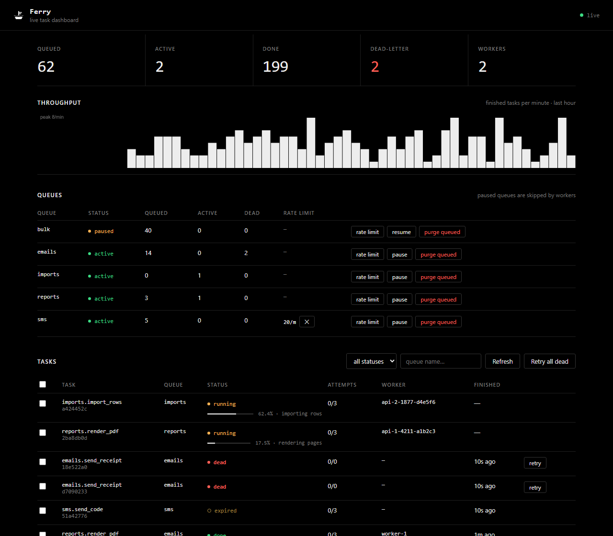
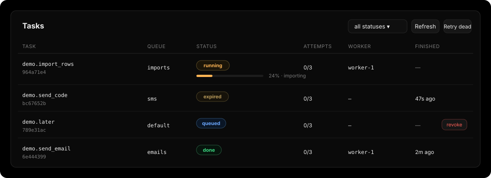
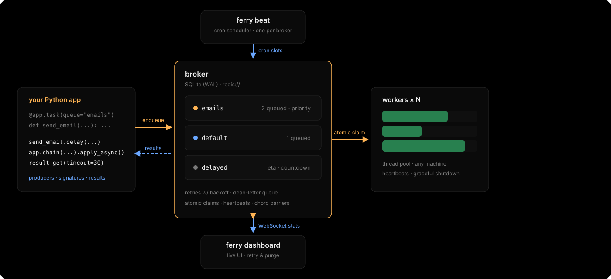

# Ferry

[](https://github.com/Sanjays2402/ferry/actions/workflows/ci.yml)
[](https://www.python.org/)
[](LICENSE)

**The task queue that starts with a single SQLite file and grows to production.** Zero broker to install, zero dependencies in the core, and the same API when you outgrow one machine: priorities, retries with backoff, cron scheduling, a dead-letter queue, crash recovery, a live dashboard, and Prometheus metrics.



## Why Ferry

Most task queues make you choose: **simple** (a Redis list and hope) or **serious** (Celery's operational sprawl). Ferry refuses the tradeoff. You get a real distributed queue backed by one SQLite file, with atomic claims so any number of workers across processes and machines share it with no double-execution. When one box stops being enough, you change a URL and keep the same API.

- **Atomic claiming** - tasks are claimed with a single atomic operation, so workers coordinate with no locks and no double-execution.
- **Real retry semantics** - exponential backoff with jitter, per-task tunables, and a dead-letter queue for poison messages.
- **Scheduling built in** - `countdown`/`eta` for delayed tasks, cron expressions for periodic ones, deduped so a schedule slot never enqueues twice.
- **Crash recovery** - workers heartbeat; the scheduler requeues tasks claimed by workers that died mid-flight.
- **Live dashboard** - queue depth, throughput charts, per-task drill-down, worker roster, one-click retry, all pushed over a WebSocket.

## 60-second quickstart

Python 3.10+. Install with dashboard support:

```bash
pip install "git+https://github.com/Sanjays2402/ferry.git[dashboard]"
```

Put a task in `tasks.py`:

```python
from ferry import Ferry

app = Ferry("tasks", broker="sqlite:///ferry.db")

@app.task(max_retries=3)
def add(a, b):
    return a + b
```

Start a worker in one terminal, enqueue in another:

```bash
ferry worker tasks:app
```

```bash
python -c "from tasks import add; print(add.delay(2, 3).get(timeout=10))"
# 5
```

That is the whole loop: define, `delay`, get a result. To see it live, run `ferry dashboard` and open http://localhost:8000. Run `ferry beat tasks:app` alongside the worker to enable cron schedules, retries, and crash recovery (one beat per broker).

`ferry` also ships [a full quickstart script](examples/quickstart.py) with 20 tasks, an urgent queue, and a cron job:

```bash
git clone https://github.com/Sanjays2402/ferry.git && cd ferry
python examples/quickstart.py worker        # terminal 1
python examples/quickstart.py enqueue       # terminal 2
ferry dashboard --broker sqlite:///ferry.db # terminal 3
```

## Features

| Area | What you get |
|---|---|
| Brokers | SQLite out of the box (WAL mode); Redis via `redis://` URLs with the same API |
| Core | **Zero dependencies** - nothing to install, nothing to break |
| Queues | Named queues, per-task priority (higher first, FIFO within a level), pause/resume |
| Retries | `max_retries`, exponential backoff with jitter, per-task `retry_backoff_base`/`max` |
| Scheduling | `countdown`, `eta`, `@app.periodic("*/5 * * * *")` cron (5-field syntax, UTC) |
| Reliability | Dead-letter queue, stale-claim recovery, task expiry, graceful shutdown, revocation |
| Workflows | `app.chain()`, `app.group()`, `app.chord()` with `Task.s()`/`Task.si()` signatures |
| Async | `async def` tasks run natively on workers; `await result.aget()` in async code |
| Observability | Events API (`task_enqueued/succeeded/failed/dead`), live WebSocket dashboard, Prometheus `/metrics` |
| Payloads | JSON with datetime/date/UUID/bytes/set support; strict errors on the rest |
| Control | Per-queue rate limits, `dedupe_key` collapsing, `ferry pause/resume/retry-dead/revoke/stats/tasks/inspect` |
| Progress | `update_progress()` inside a task, live progress bars in the dashboard |

## Usage

Retries, scheduling, and hooks in one place:

```python
@app.task(queue="emails", max_retries=5, retry_backoff_base=10)
def send_receipt(order_id: int) -> str:
    ...  # talk to your mail provider

@app.periodic("0 9 * * *")  # every morning, UTC
def send_daily_digest() -> str:
    ...

# send in one hour; if re-enqueued while pending, returns the existing task
send_receipt.apply_async(args=(order.id,), countdown=3600,
                         dedupe_key=f"receipt:{order.id}")
```

Report progress from inside long tasks and read it from anywhere:

```python
from ferry import update_progress

@app.task
def import_rows(path):
    rows = load(path)
    for i, row in enumerate(rows, 1):
        save(row)
        update_progress(i, total=len(rows), message="importing")

result = import_rows.delay("rows.csv")
result.progress  # {'current': 120, 'total': 500, 'percent': 24.0, ...}
```

Compose multi-step workflows with canvases:

```python
@app.task
def add(x, y): return x + y

@app.task
def double(x): return x * 2

app.chain(add.s(2, 3), double.s()).apply_async().get(timeout=10)      # 10
app.group(double.s(1), double.s(2), double.s(3)).apply_async().get(timeout=10)  # [2, 4, 6]
```

Full option reference ([`Ferry.task`](ferry/app.py)), [canvases](ferry/canvas.py), and [the CLI](ferry/cli.py) are documented in the code.

## Dashboard and metrics

`ferry dashboard` gives you queue depth, a per-minute throughput chart, a filterable task table with one-click retry of dead tasks, queue purge and pause/resume, a live worker roster, and a per-task inspector with arguments, result or traceback, status timeline, expiry deadline, and progress.



Prometheus scrapes the same server:

```yaml
# prometheus.yml
scrape_configs:
  - job_name: ferry
    static_configs: [{ targets: ["localhost:8000"] }]
```

The dashboard is open on localhost by default. To expose it, set a token; it protects the UI, every API route, `/metrics`, and the live feed:

```bash
export FERRY_DASHBOARD_TOKEN=<redacted>
ferry dashboard --host 0.0.0.0
```

Prefer the environment variable over `--token` so the secret stays out of the process list, and put TLS in front whenever the dashboard leaves localhost.



## Scaling past one box

Point Ferry at Redis. Same API, same guarantees; claims run as one atomic Lua script so workers stay exactly-once across machines with no extra coordination:

```python
app = Ferry("myapp", broker="redis://localhost:6379/0")
```

Needs `pip install "git+https://github.com/Sanjays2402/ferry.git[redis]"`.

## How it compares

| | Ferry | Celery | RQ | Dramatiq |
|---|---|---|---|---|
| Broker to get started | SQLite file (zero setup) | Redis/RabbitMQ | Redis | Redis/RabbitMQ |
| Priorities | Yes | Yes (kombu) | No | No |
| Cron scheduling | Yes, built in | Yes (beat) | No (needs rq-scheduler) | Yes |
| Dead-letter queue | Yes | Yes | No | Yes |
| Live dashboard | Yes, built in | No (flower, separate) | Yes (rq-dashboard) | No |
| Core dependencies | **Zero** | Many | redis | pika/redis |

## Performance

`python benchmarks/bench.py` - end-to-end throughput (enqueue to result) for no-op tasks on the SQLite broker:

| Tasks | Concurrency | Throughput |
|---|---|---|
| 2,000 | 8 | **~1,275 tasks/sec** |

Measured on a 2-vCPU Linux VM, Python 3.12. Queue overhead per task is well under a millisecond; your task's own runtime dominates in practice.

## Docs and examples

- [examples/quickstart.py](examples/quickstart.py) - worker, enqueue, and cron in one script
- [examples/fanout.py](examples/fanout.py) - fan-out/fan-in with a group
- [docs/architecture.svg](docs/architecture.svg) - how workers, the beat, and the brokers fit together
- [docs/canvases.svg](docs/canvases.svg) - chain, group, and chord at a glance
- [CHANGELOG.md](CHANGELOG.md) - every release, in Keep a Changelog format
- [CONTRIBUTING.md](CONTRIBUTING.md) - how to develop and submit changes
- [SECURITY.md](SECURITY.md) - how to report a vulnerability

## Development

```bash
git clone https://github.com/Sanjays2402/ferry.git && cd ferry
pip install -e ".[dev]"
pytest
```

176 tests, green on Python 3.10, 3.11, 3.12, and 3.13 in CI, plus `ruff` lint and a wheel-contents check on every push.

## License

MIT - see [LICENSE](LICENSE).

## Terms & Disclaimer

By using this project you agree to the following.

- **No warranty.** This software is provided "as is", without warranty of any kind, express or implied, including merchantability, fitness for a particular purpose, and non-infringement.
- **No liability.** To the maximum extent permitted by law, the author and contributors are not liable for any claim, loss, or damage (direct, indirect, incidental, or consequential, including lost data or profits) arising from its use.
- **Your responsibility.** You use it at your own risk and are responsible for complying with the laws that apply to you.
- **Your data.** Keep backups; data loss is possible. If you process other people's personal information, you are responsible for complying with privacy laws such as US state privacy laws (e.g. CCPA), PIPEDA and Quebec's Law 25 (Canada), and the Digital Personal Data Protection Act, 2023 (India).
- **Third parties.** Names, logos, APIs, and services of others belong to their owners and are used for identification only; no affiliation or endorsement is implied.
- **Your statutory rights.** Nothing here limits rights that cannot be waived by agreement, including under consumer-protection laws in the USA, Canada (including Quebec), and India (Consumer Protection Act, 2019).
- **License.** Use, copying, and distribution are governed by the [LICENSE](LICENSE) file; if anything here conflicts with it, the license controls.

## Content, Assets & Fair Use

- **Original work.** Unless noted otherwise (including below), the code, text, design, and images in this repository were created by the author.
- **Libraries, fonts, and icons.** Third-party libraries, fonts (for example Google Fonts), and icon sets belong to their creators and are used under their own licenses; see the dependency manifests and each source for terms.
- **Logos, brands, and screenshots.** Third-party names, logos, and screenshots appear only to identify or describe their products (nominative use). They remain the property of their owners and do not imply affiliation or endorsement.
- **Ideas and inspiration.** Where this project is inspired by another product, game, or idea, it is an independent implementation. It borrows only general ideas, mechanics, or styles, which are not anyone's exclusive property, and is meant to contain no third-party code or artwork used without permission.
- **Fair use and fair dealing.** Any third-party material is used in limited ways for purposes such as education, research, review, commentary, or identification, relying on fair use in the USA (17 U.S.C. § 107), fair dealing in Canada (Copyright Act, ss. 29–29.2), and fair dealing in India (Copyright Act, 1957, s. 52), where they apply.
- **Concerns and takedown requests.** If you own rights in something here and believe it is used improperly, [open an issue](https://github.com/Sanjays2402/ferry/issues) or contact the author through their GitHub profile with a link to the material and your claim. It will be reviewed promptly and credited, changed, or removed as appropriate. You may also use GitHub's DMCA process.
- **Contributions.** By contributing, you confirm you have the right to submit your contribution and agree it is licensed under this repository's license.
